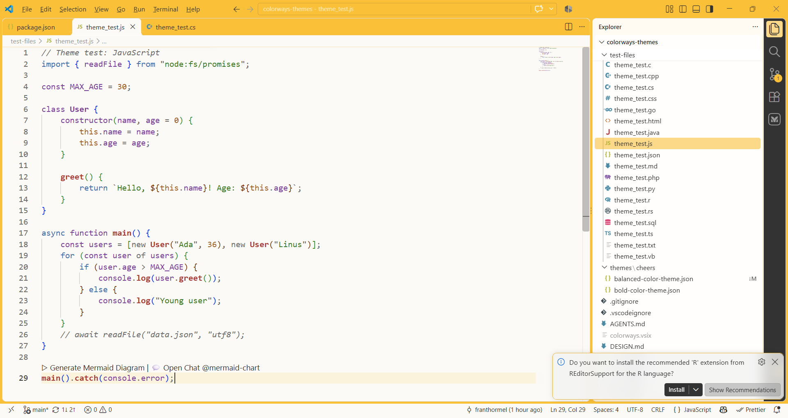
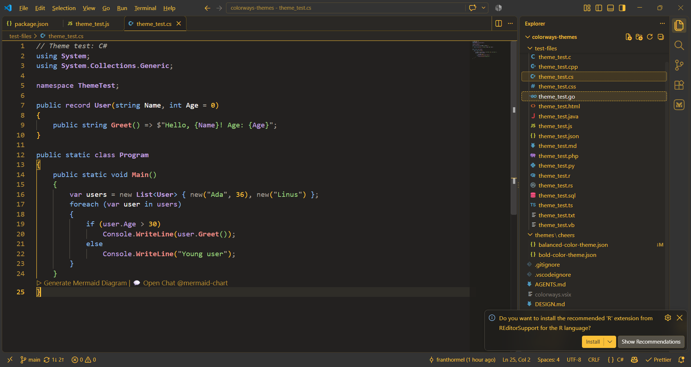

# [Colorways VS Code](https://marketplace.visualstudio.com/items?itemName=Franthormel.colorways)

Themes inspired by [Firefox Colorways](https://support.mozilla.org/en-US/kb/personalize-firefox-colorways).

## Screenshots

### 🍻 Cheers


Balanced


Bold

## Availability

| Theme name (style) | Status    |
| ------------------ | --------- |
| Cheers (Balanced)  | Available |
| Cheers (Bold)      | Available |
| Cheers (Soft)      | WIP       |

## Releasing instructions for developer

1. Take screenshot of the editor with the theme applied
2. Copy the screenshot into the `/images/preview` directory
3. Update the availability table in the `README` file
4. Include the new screenshot in `README` file
5. Bump `version` in `package.json` for every publish.

## Packaging and publishing

1. Install vsce.

```
npm install -g @vscode/vsce
```

2. [Package] This creates a .vsix file in the root directory.

```
vsce package
```

3. [Test] Run below OR install manually via Extensions > Install from VSIX...

```
code --install-extension colorways-0.2.2.vsix
```

4. Publish changes

```
vsce publish
```

See https://code.visualstudio.com/api/working-with-extensions/publishing-extension for more information.
